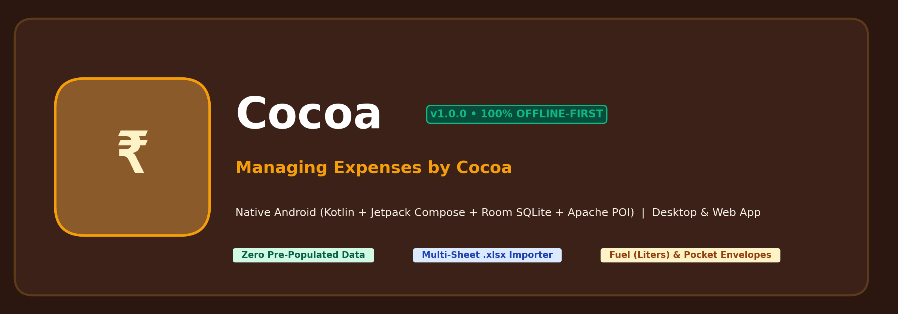
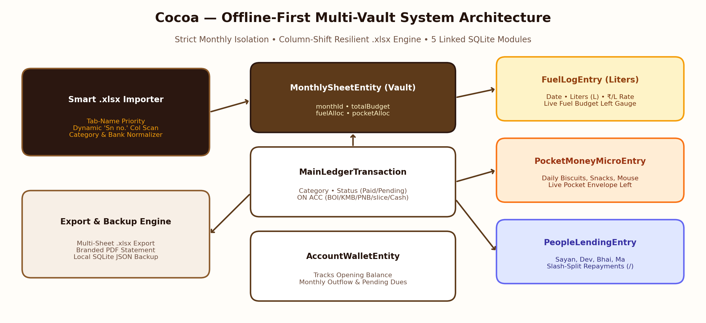

<div align="center">



# Cocoa — Managing Expenses by Cocoa
**100% Offline-First Native Android App & Desktop Personal Finance, Sub-Budget, Investment & Multi-Sheet Excel (`.xlsx`) Vault**

[](#1-download--install-on-your-android-smartphone-1-click-apk)
[-2B1710?style=for-the-badge&logo=android&logoColor=F59E0B)](#3-repository-structure--native-android-architecture)
[](#2-run-on-your-laptop--desktop-windows--mac--linux)
[](#4-strict-offline-data-isolation--5-linked-sqlite-modules)

</div>

---

## 🚀 Quick Start: Smartphone APK & Laptop Showcase

### 1. Download & Install on Your Android Smartphone (1-Click `.apk`)
Once this repository is pushed to GitHub, **GitHub Actions** automatically compiles the native Android app and publishes **`Cocoa-Managing-Expenses.apk`** directly to your repository's **Releases** section:
1. Open this repository on your Android smartphone and tap **Releases** (on the right sidebar or top repository menu).
2. Under the latest release, tap **`Cocoa-Managing-Expenses.apk`** to download it directly to your phone.
3. Tap the downloaded `.apk` notification and confirm **Install** (allow *"Install from this source"* if prompted).
4. Optional: Download [`sample-data/Cocoa_Sample_MultiSheet_Tracker.xlsx`](sample-data/Cocoa_Sample_MultiSheet_Tracker.xlsx) to test the multi-sheet Excel importer immediately.

### 2. Run on Your Laptop / Desktop (Windows, macOS & Linux)
You can run **Cocoa** directly on your laptop with zero heavy IDE setup, or open the native Kotlin source inside Android Studio:
- **Instant Browser Launch (No Setup Required):** Double-click [`docs/index.html`](docs/index.html) (or double-click `Launch_Cocoa_Windows.bat` on Windows / `./Launch_Cocoa_Mac_Linux.sh` on macOS & Linux) to launch the complete **Cocoa Desktop & Mobile Studio** locally at `http://localhost:8085`.
- **Live GitHub Pages Showcase:** When pushed to GitHub, the [`build-and-release.yml`](.github/workflows/build-and-release.yml) workflow automatically deploys `docs/` to **GitHub Pages** so your project is hosted live on a shareable URL.
- **Android Studio (Full Native IDE):** Open the root folder in **Android Studio Ladybug (or newer)**, let Gradle sync, and click **Run (`Shift+F10`)** or **Build → Build Bundle(s) / APK(s) → Build APK(s)**.

---

## 🎨 Brand Identity & "Chocolate & White" Aesthetic System

**Cocoa** combines a warm **Artisanal Chocolate & Alabaster White** structural canvas with vibrant semantic category badges and neo-brutalist card depth:

| Design Token | Hex Code | Usage in Cocoa UI |
| :--- | :--- | :--- |
| **Warm White / Cream** | `#FFFDF9` | Primary app background canvas |
| **Alabaster Milk** | `#F7EFE6` | Secondary card surface & filter strips |
| **Dark Espresso Chocolate** | `#2B1710` | Hero "Final Data" Master Card, Top/Bottom Bars, Splash Screen |
| **Rich Cocoa Bean** | `#5D3A1A` | Primary brand accent & interactive borders |
| **Caramel Ganache** | `#8B5A2B` | Secondary brand accent, progress bars & active nav indicators |
| **Hairline Divider** | `#E5D5C5` | Card outlines & subtle table hairlines |
| **Deep Espresso Text** | `#23120B` | High-contrast primary typography on white |

### Vibrant Semantic Category Icons & Payment Account (`ON ACC`) Badges
- **🌱 Investments (`SIP` / `HSBC`):** Emerald Mint (`#10B981` on `#D1FAE5`)
- **⚡ Utilities & Bills (`Wi-Fi`, `Mobile`, `Electricity`):** Electric Cobalt (`#3B82F6` on `#DBEAFE`)
- **⛽ Fuel & Vehicle (`Petrol Liters`, `2T Oil`, `Bike Service`):** Amber Flame (`#F59E0B` on `#FEF3C7`)
- **☕ Pocket Money & Daily Micro-Spends:** Vibrant Coral (`#F97316` on `#FFEDD5`)
- **🛍️ Shopping & Lifestyle (`Apparel`, `Puja`, `Gifts`):** Royal Violet (`#8B5CF6` on `#EDE9FE`)
- **🏋️ Gym & Fitness:** Crimson Rose (`#EC4899` on `#FCE7F3`)
- **🎓 Education & Certificates:** Cyan Teal (`#06B6D4` on `#CFFAFE`)
- **💳 EMI, Loans & Credit Cards:** Ruby Red (`#EF4444` on `#FEE2E2`)
- **🤝 Borrowed / People Lending (`Sayan`, `Dev`, `Bhai`, `Ma`):** Indigo Gold (`#6366F1` on `#E0E7FF`)
- **🏦 Payment Account Badges (`ON ACC`):** Distinct badges for **`BOI`** (Navy & Star Orange), **`KMB`** (Crimson & Navy), **`PNB`** (Maroon & Gold), **`slice`** (Neon Purple `#7C3AED`), and **`Cash`** (Forest Green `#16A34A`).

---

## 🏗️ System Architecture & 5 Linked SQLite Modules



### Critical Data Rule: Clean Empty Database on Launch
Cocoa strictly initializes with a **clean, empty local database** (`CocoaDatabase.kt` / local storage)—zero historical July–November transactions are hardcoded into the default app state.

### Five Linked Modules Inside Every Isolated Monthly Vault (`MonthlySheetEntity`)
1. **`MainLedgerTransaction`:** Tracks `serialNo`, `description`, normalized `category`, `amount`, `status` (`PAID` / `PENDING`), `accountTag` (`BOI`, `KMB`, `PNB`, `SLICE`, `CASH`, `UNSPECIFIED`), `createdAtDate`, `notes`, and `isSubBudgetAnchor` (`FUEL_ANCHOR`, `POCKET_MONEY_ANCHOR`, `NONE`).
2. **`FuelLogEntry` (Linked to Monthly Fuel Sub-Budget):** Logs `date`, `liters` (e.g., `3.09 L`, `4.18 L`), `amount` (`₹`), auto-calculated `pricePerLiter` (`₹/L`), and live `Budget Left for Fuel = Fuel_Anchor_Amount - SUM(FuelLogEntry.amount)`.
3. **`PocketMoneyMicroEntry` (Linked to Monthly Pocket Money Envelope):** Logs daily micro-expenses (`Good Day Biscuit`, `EvoFox Gaming Mouse`, `Momos & Chai`) and computes live `Pocket Money Left`.
4. **`PeopleLendingAndRepaymentEntry`:** Tracks `BORROWED`, `LENT_OR_GIVEN`, and `SPLIT_REPAYMENT` entries (`Sayan Ghosh`, `Bhai`, `Ma`, `Dev`) including slash-separated multi-item breakdowns (`mobile recharge - 350 / wifi recharge - 471 / 2t oil 500 ml - 160 / petrol 3lt - 350`).
5. **`AccountWalletEntity`:** Tracks opening balance (`Total balance /-`), paid monthly outflow, and pending dues across `BOI`, `KMB`, `PNB`, `slice`, and `Cash`.

---

## 📊 Intelligent Multi-Sheet Excel (`.xlsx`) Importer & Exporter

Located in [`SmartExcelEngine.kt`](app/src/main/java/com/cocoa/expenses/excel/SmartExcelEngine.kt), the parser handles real-world multi-sheet personal trackers:
- **Worksheet Tab-Name Priority:** Uses the worksheet tab name (`July Expense Tracker `, `September expense tracker  `) rather than internal copy-pasted title cells (such as `"AUGUST Expense Tracker"` inside September).
- **Column-Shift Resilient Scanning:** Dynamically scans the first 10 rows & 10 columns for `Sn no.` so sheets starting in Column B (July–Oct) or shifted to Column A (November) import seamlessly.
- **Side-by-Side Sub-Table Extraction:** Automatically locates right-hand `LITERS` tables (stopping before `TOTAL LTRS`), secondary `TRANSACTIONS` + `budget left` tables for Pocket Money, and `NAME` / `pay ment of` blocks for People & Repayments.
- **Smart Normalization:** Unifies `utlities`/`Utilities`/`bills` → `Utilities & Bills`, `Misclienious` → `Miscellaneous`, `loan`/`instalments` → `EMI & Credit Cards`, `Paid`/`done` → `PAID`, and `on pnb`/`on kmb`/`slice ` → canonical bank tags.

---

## 📂 Repository Directory Structure

```text
Cocoa/
├── .github/workflows/
│   └── build-and-release.yml          # Auto-compiles Android APK, creates GitHub Release & deploys Pages
├── app/
│   ├── build.gradle.kts               # Android app Gradle config (Compose, Room 2.6.1, Apache POI 5.2.5)
│   └── src/main/
│       ├── AndroidManifest.xml        # Zero internet permissions (100% Offline-First guarantee)
│       ├── assets/
│       │   └── cocoa_app.html         # Embedded offline interactive asset bundle
│       └── java/com/cocoa/expenses/
│           ├── MainActivity.kt        # Native Android entry point
│           ├── CocoaRootApp.kt        # 4-Tab Compose scaffold, Onboarding, Vault, Timelines, Analytics, Legal
│           ├── data/
│           │   ├── Entities.kt        # 5 Room SQLite Entities & Enums
│           │   ├── CocoaDao.kt        # Coroutines Flow reactive DAOs
│           │   └── CocoaDatabase.kt   # Clean empty Room database singleton
│           ├── excel/
│           │   └── SmartExcelEngine.kt# Column-shift resilient multi-sheet .xlsx parser & exporter
│           ├── ui/theme/
│           │   ├── Color.kt           # Chocolate & White palette + Vibrant Semantic category tokens
│           │   └── Theme.kt           # Material 3 Compose theme configuration
│           └── util/
│               └── CocoaHaptics.kt    # Native CLOCK_TICK, CONFIRM & REJECT vibration controller
├── docs/
│   ├── index.html                     # Full interactive Laptop/Desktop & PWA showcase app
│   └── assets/
│       ├── hero_banner.png            # Repository brand header
│       └── architecture_diagram.png   # Multi-vault system architecture diagram
├── sample-data/
│   └── Cocoa_Sample_MultiSheet_Tracker.xlsx # 5-Sheet test workbook (July–Nov with shifted columns)
├── launch_cocoa_laptop.py             # Cross-platform Python desktop server launcher
├── Launch_Cocoa_Windows.bat           # 1-Click Windows laptop launcher
├── Launch_Cocoa_Mac_Linux.sh          # 1-Click macOS / Linux laptop launcher
├── build.gradle.kts                   # Root Kotlin & AGP build configuration
├── settings.gradle.kts                # Project settings
├── CONTRIBUTING.md                    # Developer setup & contribution guide
└── LICENSE                            # MIT License
```

---

## 🔒 Offline Privacy Policy & Legal Standards
- **100% Offline Execution:** Cocoa requests **zero internet permissions** (`android.permission.INTERNET` is omitted from `AndroidManifest.xml`). All financial records, bank balances, and Excel workbooks stay strictly in local device storage.
- **License:** Distributed under the [MIT License](LICENSE).
